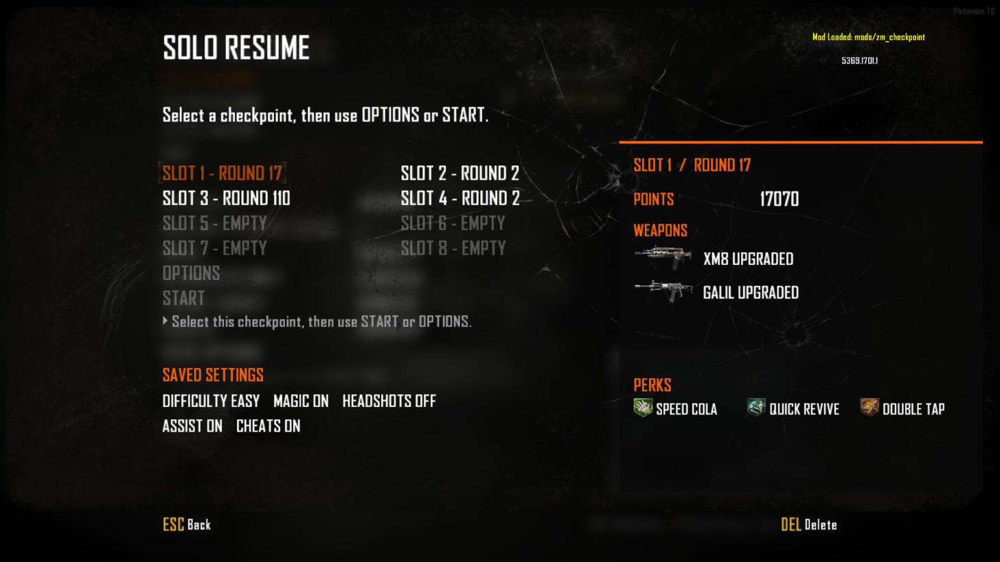
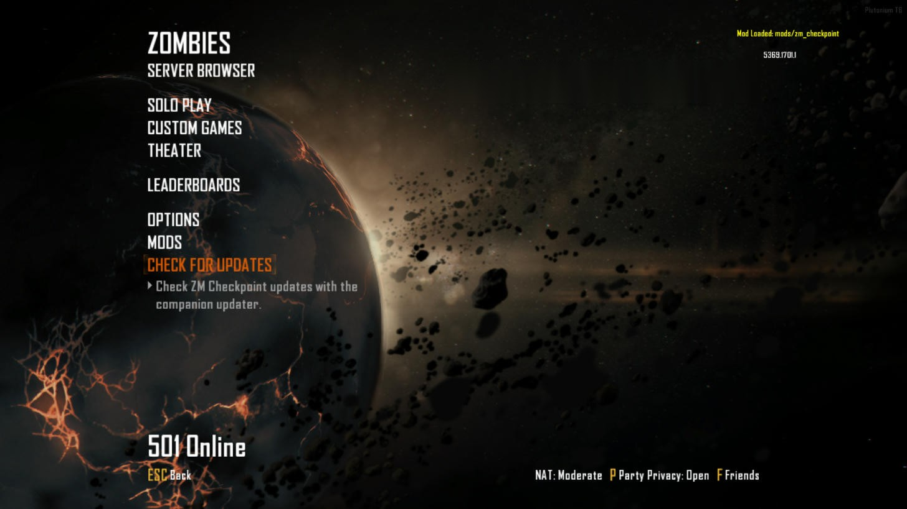
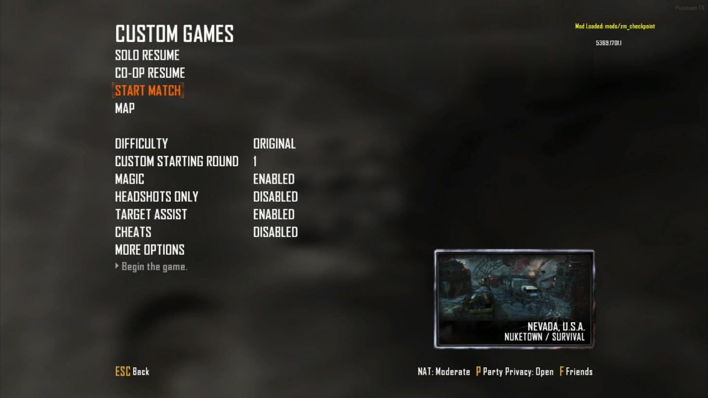

<div align="center">

# ZM Checkpoint

Save a Black Ops II Zombies game on [Plutonium T6](https://plutonium.pw) and pick it back up later.

[](https://github.com/PourquoiPasMoi/zm-checkpoint/releases)
[](https://github.com/PourquoiPasMoi/zm-checkpoint/releases)


[Download](https://github.com/PourquoiPasMoi/zm-checkpoint/releases/download/0.4.46-alpha/zm_checkpoint-0.4.46-alpha.zip) · [Install](#install) · [How to use it](#how-to-use-it) · [What works](#what-works-and-what-doesnt)

</div>

<p align="center"></p>

## What it does

The mod adds a SAVE & EXIT button to the pause menu and a SOLO RESUME page to the Custom Games lobby. Resuming puts you back on the round you saved, with your points, weapons and perks.

It also adds a few things around that:

- 8 save slots per map, each with a preview of what's inside
- optional autosave at the end of every round
- a MORE OPTIONS page for new games: starting round, points, weapons and perk, power and doors, unlimited perks, and a cap on zombie health
- a counter showing how many zombies are left in the round
- an updater you can run from the game menu (Windows)

This is an alpha. Saving and resuming works on the maps I've tested, but some maps and some of the newer features haven't been tested properly yet. The details are under [What works and what doesn't](#what-works-and-what-doesnt).

## Install

1. Download [`zm_checkpoint-0.4.46-alpha.zip`](https://github.com/PourquoiPasMoi/zm-checkpoint/releases/download/0.4.46-alpha/zm_checkpoint-0.4.46-alpha.zip).
2. Open this folder (you can paste the path into File Explorer) and make a new folder in it called `zm_checkpoint`:
   ```
   %localappdata%\Plutonium\storage\t6\mods
   ```
3. Extract the zip into `zm_checkpoint`. `mod.json` should end up directly inside that folder.
4. Start BO2 Zombies in Plutonium, open Mods and load zm_checkpoint.

When it's loaded, the top right corner says `Mod Loaded: mods/zm_checkpoint` and the menu has a CHECK FOR UPDATES row.

<p align="center"></p>

<details>
<summary>Optional: the in-game updater</summary>

<br>

The updater needs a small helper running in the background. Before you use CHECK FOR UPDATES, double-click `Launch-UpdateBridge.vbs` in the `zm_checkpoint` folder.

That starts a hidden PowerShell script (`Watch-ZMCheckpointUpdates.ps1`). It waits for the game to ask for an update, downloads the new release from this repository and copies it into the mod folder. It doesn't touch your saves. Both files are plain text if you want to read them first.

If you'd rather not run it, the mod works the same and you update by downloading the new zip.

</details>

## How to use it

### Saving a game

In a solo game, open the pause menu and choose SAVE & EXIT, then pick one of the eight slots.

<p align="center"></p>

An empty slot is used right away. If the slot already has a save, you have to select it a second time to overwrite it. The old save is kept as a backup and comes back if the new save fails.

When the save is done you're sent back to the lobby.

### Resuming

In the Custom Games lobby, pick the same map and choose SOLO RESUME.

<p align="center"></p>

The slots are laid out in two columns and empty ones are greyed out. Highlight a slot to see its round, points, weapons, perks and match settings. Click it to select it, then choose START.

<p align="center"></p>

A save is used up when you resume it. If you want to keep it for another day, Save & Exit again before you quit, or turn on autosave.

### Changing a save before you load it

Select a slot on the SOLO RESUME page and choose OPTIONS. For that save only, you can change:

- difficulty, Magic, Headshots Only, Target Assist and Cheats
- Unlimited Perks, which removes the four perk limit
- Zombie Health Cap, so zombies stop getting tougher after the round you pick
- Autosave, to keep saving into a slot at the end of each round

<p align="center"></p>

Choose APPLY CHANGES to keep them. The save file itself isn't modified.

### Deleting a save

Highlight a slot on the SOLO RESUME page and press DEL. It asks you to confirm, and "NO, KEEP" is selected by default.

### More options for new games

Open MORE OPTIONS in Custom Games. These only apply when you start a new game. A resumed save keeps what it had.

<p align="center"></p>

| Option | Choices | What it does |
|---|---|---|
| Unlimited Perks | On / Off | Lets you buy every perk on the map. |
| Starting Weapons | None, 1 or 2 random, 1 or 2 Pack-a-Punched | You spawn with random guns from that map's wall buys and Mystery Box. |
| Starting Perk | None / 1 random | You spawn with a random perk from that map's machines. |
| Starting Points | Default, or any amount up to 1,000,000 | Click the row and type a number. |
| Opening | Normal, Power On, Doors Open, Power + Doors | Starts with the power on, or every door and debris pile opened for free, or both. |
| Zombie Health Cap | Off, or any round from 1 to 255 | Zombies stop getting tougher after that round. Rounds and zombie counts keep growing. |
| Autosave | Off, or a solo slot | Saves into that slot when each round ends. |

In the Survival lobby the starting round row is called CUSTOM STARTING ROUND. Use left and right to change it, or click it and type any round from 1 to 255.

Wonder weapons you have to build or earn (Jet Gun, Sliquifier, Paralyzer, the staffs) are never given as starting weapons.

### Zombie counter

During a game, the red number in the top left corner is how many zombies are left in the round. Press 0 (or numpad 0) to show or hide it.

<p align="center"></p>

### Updating

On the Zombies main menu, choose CHECK FOR UPDATES. This needs the helper described under [Install](#install).

<p align="center"></p>

The panel on the right shows the latest release notes, with PREV PAGE and NEXT PAGE for long ones. If there's a new version you can choose INSTALL UPDATE or NOT NOW. After an install, choose UNLOAD (or press U) and load the mod again from the Mods menu. Press R to check again.

Updating only replaces the mod's own files, so your saves stay where they are.

## What works and what doesn't

All six maps are included. This is what has been tested so far:

| Map | Status |
|---|---|
| Nuketown | Full save and resume works. |
| TranZit | Round, weapons, points, position, round HUD and zombie spawning all come back. |
| Buried | Same as TranZit, plus the doors and debris you opened. |
| Die Rise | Included, not properly tested yet. |
| Mob of the Dead | Included, not properly tested yet. |
| Origins | Included, not properly tested yet. |

The newer menu features (the 8 slot grid, autosave, per-save options, save preview and delete) haven't had much in-game testing either.

Known limits:

- Easter egg and quest progress is not saved.
- Solo is the supported mode. Co-op saving (2 to 4 players, stored on the host) is in the mod as an experiment, but a full co-op save and resume hasn't worked yet. If you want to help test it, see [COOP_TEST_PLAN.md](COOP_TEST_PLAN.md).
- Dedicated servers are not supported.
- The in-game save page lists weapon names without pictures. The pictures are only available in the lobby, on SOLO RESUME.
- A few weapons have no menu picture in the game files (the M27, LSAT, AN-94 and Ray Gun Mark II, for example), so the preview shows their names only.
- Round 255 is the engine's limit, and very high rounds are heavy on the game.

## Troubleshooting

<details>
<summary>SOLO RESUME shows no saves</summary>

<br>

Check that the mod is loaded (top right corner of the menu) and that you picked the same map the save was made on. A save you've already resumed is gone, which is how it's meant to work.

</details>

<details>
<summary>The updater stays on "Waiting for the update companion"</summary>

<br>

The background helper isn't running. Double-click `Launch-UpdateBridge.vbs` in the mod folder, then press R on the updater page.

</details>

<details>
<summary>The menus didn't change after an update</summary>

<br>

Unload the mod and load it again from the Mods menu. You don't need to restart Plutonium.

</details>

## Feedback

If you find a bug, or you've tried a map that isn't confirmed yet, please [open an issue](https://github.com/PourquoiPasMoi/zm-checkpoint/issues). It helps to include the map and the round, what did or didn't come back after resuming, and a screenshot. If you can, also attach `console_zm.log` from `%localappdata%\Plutonium\storage\t6\main`.

## For developers

The GSC and Lua sources are in [`src/`](src) and the build and install scripts are in [`tools/`](tools). Notes on what each map saves are in [MAP_STATE_AUDIT.md](MAP_STATE_AUDIT.md). Release notes for every version are on the [Releases page](https://github.com/PourquoiPasMoi/zm-checkpoint/releases).

## Credits and license

The LUI loading and menu wrapper approach was adapted from [ZPause](https://github.com/Xeptix/ZPause) by Xeptix (MIT). Thanks to the Plutonium team for the client and the T6 modding documentation. The perk icons are the game's own artwork and belong to Activision.

No general license has been chosen for this project yet. See [LICENSE-NOTICE.md](LICENSE-NOTICE.md) and [THIRD_PARTY_NOTICES.md](THIRD_PARTY_NOTICES.md).
