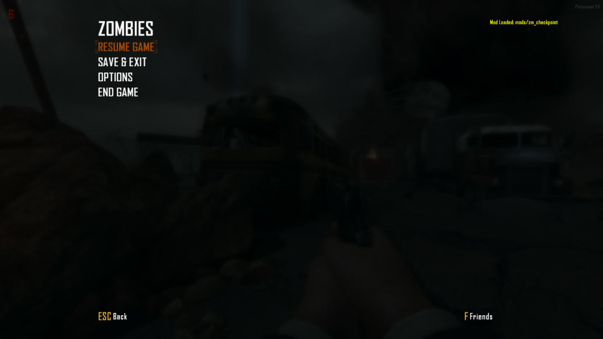
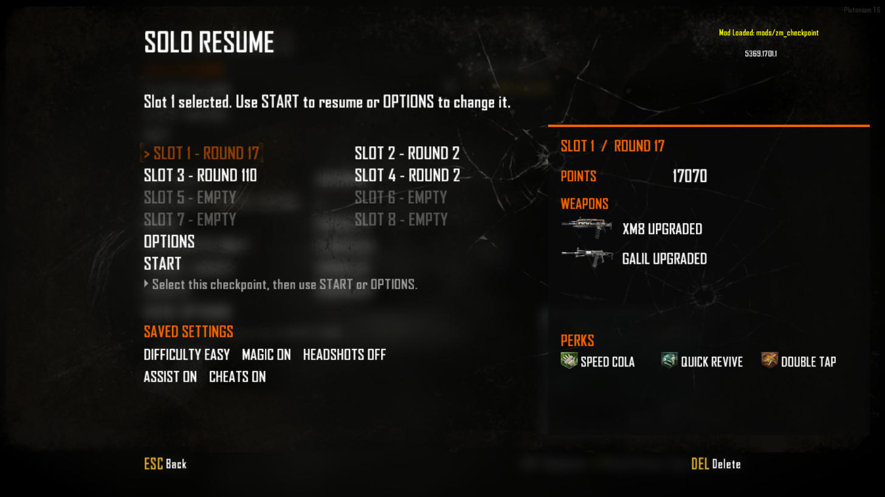
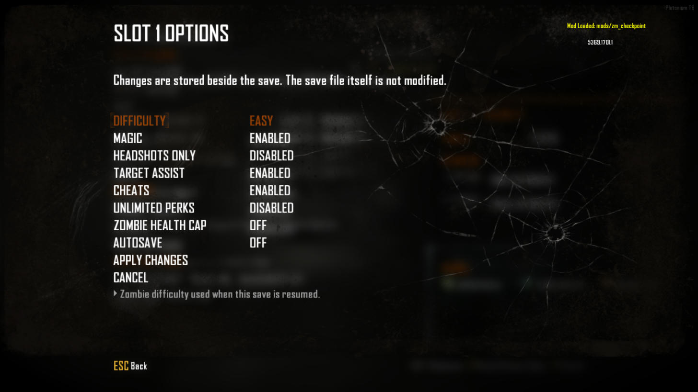
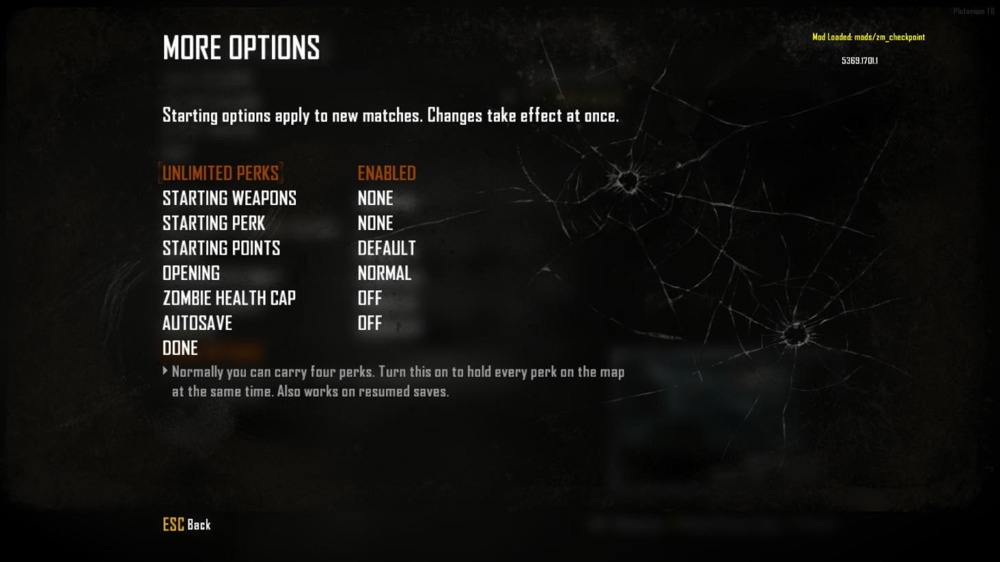
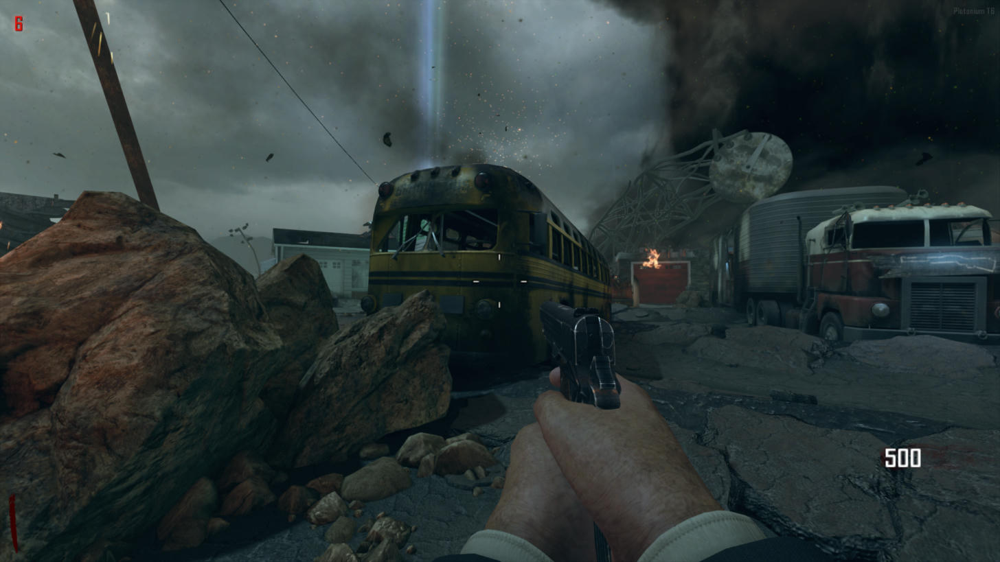
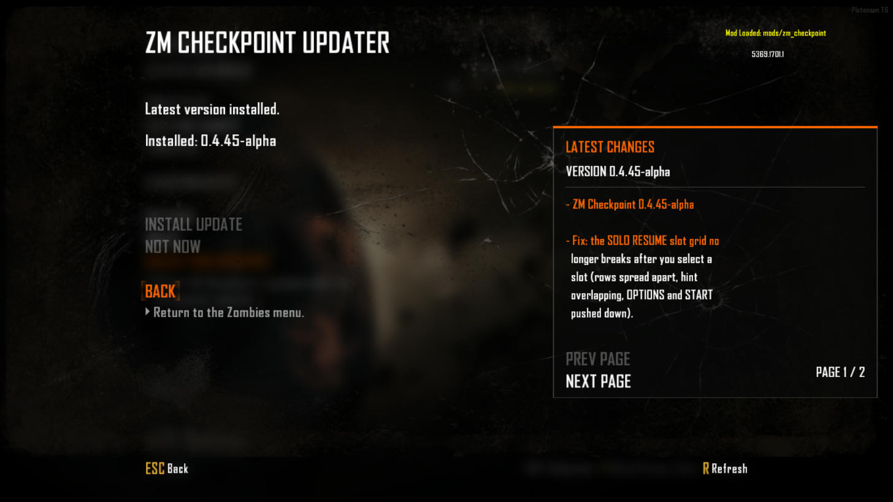

<div align="center">

# ZM Checkpoint

**Save your Black Ops II Zombies match. Come back later. Keep going.**

A mod for [Plutonium T6](https://plutonium.pw) that adds Save & Exit, Resume, autosave and extra lobby options to Zombies.

[](https://github.com/PourquoiPasMoi/zm-checkpoint/releases)
[](https://github.com/PourquoiPasMoi/zm-checkpoint/releases)


[**Download**](https://github.com/PourquoiPasMoi/zm-checkpoint/releases/download/0.4.45-alpha/zm_checkpoint-0.4.45-alpha.zip) · [Install](#install) · [How to use it](#how-to-use-it) · [What is tested](#what-is-tested)

</div>

<p align="center"></p>

---

## What it does

| | |
|---|---|
| **Save & Exit** | Leave a solo match from the pause menu and keep your round, points, weapons and perks. |
| **Resume** | Pick a save in the lobby and continue from the same round. |
| **8 save slots per map** | Each slot shows a preview of what is inside before you load it. |
| **Autosave** | Optional. Saves into a slot you choose at the end of every round. |
| **More lobby options** | Starting round, points, weapons, perk, power and doors, unlimited perks, zombie health cap. |
| **Zombies left counter** | A small counter in the top-left corner shows how many zombies remain in the round. Press **0** to hide it. |
| **In-game updater** | Check for new versions and install them from inside the game (Windows). |

> **This is an alpha.** The core save and resume works. Not every feature has been tested on every map yet. See [What is tested](#what-is-tested).

---

## Install

1. **Download** [`zm_checkpoint-0.4.45-alpha.zip`](https://github.com/PourquoiPasMoi/zm-checkpoint/releases/download/0.4.45-alpha/zm_checkpoint-0.4.45-alpha.zip).
2. **Create** a folder named `zm_checkpoint` here (paste the path into File Explorer):
   ```
   %localappdata%\Plutonium\storage\t6\mods
   ```
3. **Extract** the ZIP into that `zm_checkpoint` folder. `mod.json` must sit directly inside it.
4. **Start** BO2 Zombies in Plutonium, open **Mods**, and load **zm_checkpoint**. The top-right corner shows `Mod Loaded: mods/zm_checkpoint`, and the menu gains a **CHECK FOR UPDATES** row.

<p align="center"></p>

That is all you need to save and resume.

<details>
<summary><b>Optional: turn on the in-game updater</b></summary>

<br>

The updater needs a small helper running in the background. Before you use **CHECK FOR UPDATES**, double-click `Launch-UpdateBridge.vbs` inside the `zm_checkpoint` folder.

It starts a hidden PowerShell script (`Watch-ZMCheckpointUpdates.ps1`) that waits for the game's update request, downloads the new release from this repository, and copies it into the mod folder. Your saves are never touched. Both files are plain text, so you can read them first.

If you skip this, the mod works the same. You just update by downloading the new ZIP yourself.

</details>

---

## How to use it

### 1. Save a match

In a **solo** match, open the pause menu and choose **SAVE & EXIT**. Pick one of the eight slots.

<p align="center"></p>

- An empty slot is used straight away.
- A slot that already has a save asks you to select it a second time before it is replaced.
- The previous save in that slot is kept as a backup and comes back if the new save fails.

You are returned to the lobby when the save is done.

### 2. Resume a match

In the **Custom Games** lobby, pick the same map and choose **SOLO RESUME**.

<p align="center"></p>

- Slots are shown in two columns. Empty slots are greyed out.
- Highlight a slot to see its **round, points, weapons, perks and match settings**.
- Click a slot to select it, then choose **START**.

<p align="center"></p>

A save is **used up when you resume it**. Save & Exit again before you quit, or turn on autosave.

### 3. Change a save before loading it

On the SOLO RESUME page, select a slot and choose **OPTIONS**. You can change, for that save only:

| Option | What it does |
|---|---|
| Difficulty, Magic, Headshots Only, Target Assist, Cheats | The normal match settings, applied when the save loads. |
| Unlimited Perks | Removes the four-perk limit. |
| Zombie Health Cap | Zombies stop getting tougher after the round you pick. |
| Autosave | Keeps saving into a slot at the end of each round. |

<p align="center"></p>

Choose **APPLY CHANGES** to keep them. The save file itself is not modified.

### 4. Delete a save

On the SOLO RESUME page, highlight a slot and press **DEL**. A confirmation asks first, and **NO, KEEP** is selected by default.

### 5. Set up a new match with MORE OPTIONS

In Custom Games, open **MORE OPTIONS**. These apply to **new** matches. A resumed save keeps its own state.

<p align="center"></p>

| Option | Choices | In simple terms |
|---|---|---|
| **Unlimited Perks** | On / Off | Buy every perk on the map. |
| **Starting Weapons** | None, 1 or 2 random, 1 or 2 Pack-a-Punched | Spawn with random guns from that map's wall buys and Mystery Box. |
| **Starting Perk** | None / 1 random | Spawn with a random perk from that map's machines. |
| **Starting Points** | Default, or any amount up to 1,000,000 | Click the row and type a number. |
| **Opening** | Normal, Power On, Doors Open, Power + Doors | Start with the power on and/or every door and debris pile opened for free. |
| **Zombie Health Cap** | Off, or any round 1 to 255 | Zombies stop getting tougher after that round. Rounds and zombie numbers keep growing. |
| **Autosave** | Off, or a solo slot | Saves into that slot when each round ends. |

In the **Survival** lobby, the starting round row becomes **CUSTOM STARTING ROUND**: use left and right to change it, or click it and type any round from 1 to 255.

Wonder weapons you have to build or earn (Jet Gun, Sliquifier, Paralyzer, the staffs) are never given as starting weapons.

### 6. Zombies left counter

During a match, the red number in the top-left corner is how many zombies are left in the current round. Press **0** (or numpad 0) to show or hide it.

<p align="center"></p>

### 7. Update the mod

On the Zombies main menu, choose **CHECK FOR UPDATES** (needs the optional helper from [Install](#install)).

<p align="center"></p>

- The **LATEST CHANGES** panel shows the newest release notes. Use **PREV PAGE** and **NEXT PAGE** for long notes.
- If a new version exists, choose **INSTALL UPDATE** or **NOT NOW**.
- When the install finishes, choose **UNLOAD** (or press **U**), then load the mod again from the Mods menu.
- Press **R** to check again.

Updates replace the mod's files only. Saves are left alone.

---

## What is tested

| Map | Status |
|---|---|
| **Nuketown** | Full Save & Exit, then Resume into an active round. **Works.** |
| **TranZit** | Round, weapons, points, position, round HUD and zombie spawning restore. **Works.** |
| **Buried** | The above, plus opened doors and debris. **Works.** |
| **Die Rise** | Included. Not properly tested yet. |
| **Mob of the Dead** | Included. Not properly tested yet. |
| **Origins** | Included. Not properly tested yet. |

Some of the newest menu features (the 8-slot grid, autosave, per-save options, save preview and delete) have been checked by the build tools but have had little in-game testing.

### Known limits

- **Easter egg and quest progress is not saved.**
- **Solo is the supported mode.** Co-op team saves (host-stored, 2 to 4 players) are in the mod as an experiment, but a full co-op save and resume has not been confirmed working. See [COOP_TEST_PLAN.md](COOP_TEST_PLAN.md) if you want to help test it.
- Dedicated servers are not supported.
- On the in-game SAVE & EXIT slot page, weapon pictures show as blank boxes (names are still shown). They display correctly on SOLO RESUME.
- A few weapons have no menu picture in the game files (for example the M27, LSAT, AN-94 and Ray Gun Mark II). They show as text in the save preview.
- Round 255 is the engine's own limit, and very high rounds are heavy on the game.

---

## Troubleshooting

<details>
<summary><b>SOLO RESUME shows no saves</b></summary>

<br>

Make sure the mod is loaded (the top right of the menu shows `Mod Loaded: mods/zm_checkpoint`) and that you selected the same map the save was made on. A save you already resumed is gone by design.

</details>

<details>
<summary><b>The updater stays on "Waiting for the update companion"</b></summary>

<br>

The background helper is not running. Double-click `Launch-UpdateBridge.vbs` in the mod folder, then press **R** on the updater page.

</details>

<details>
<summary><b>The menus did not change after an update</b></summary>

<br>

Unload the mod and load it again from the Mods menu. Plutonium itself does not need a restart.

</details>

---

## Feedback

Found a bug, or tested a map that is not confirmed yet? [Open an issue](https://github.com/PourquoiPasMoi/zm-checkpoint/issues) with:

- the map and the round,
- what did or did not come back after Resume,
- a screenshot, and `console_zm.log` from `%localappdata%\Plutonium\storage\t6\main` if you can.

---

## For developers

The GSC and Lua sources are in [`src/`](src), and the build and install scripts are in [`tools/`](tools). Notes on what each map saves are in [MAP_STATE_AUDIT.md](MAP_STATE_AUDIT.md). Release notes for every version are on the [Releases page](https://github.com/PourquoiPasMoi/zm-checkpoint/releases).

## Credits and license

- **[ZPause](https://github.com/Xeptix/ZPause)** by Xeptix (MIT): the LUI loading approach and stock-menu wrapper pattern were adapted from it.
- The **Plutonium** team, for the client and the T6 modding documentation.
- Perk icons come from the game's own artwork, which belongs to Activision.

No general license has been chosen for this project yet. See [LICENSE-NOTICE.md](LICENSE-NOTICE.md) and [THIRD_PARTY_NOTICES.md](THIRD_PARTY_NOTICES.md).
